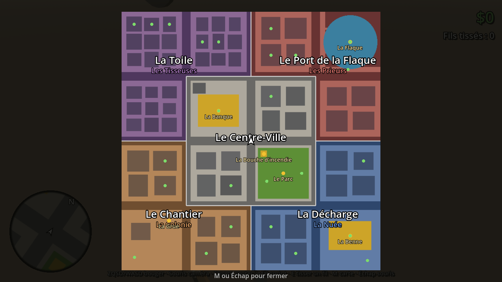
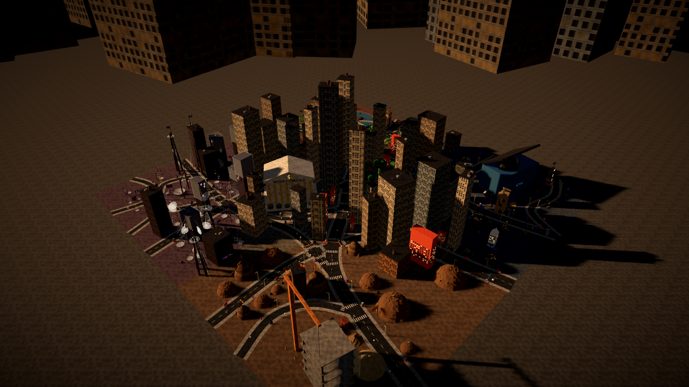
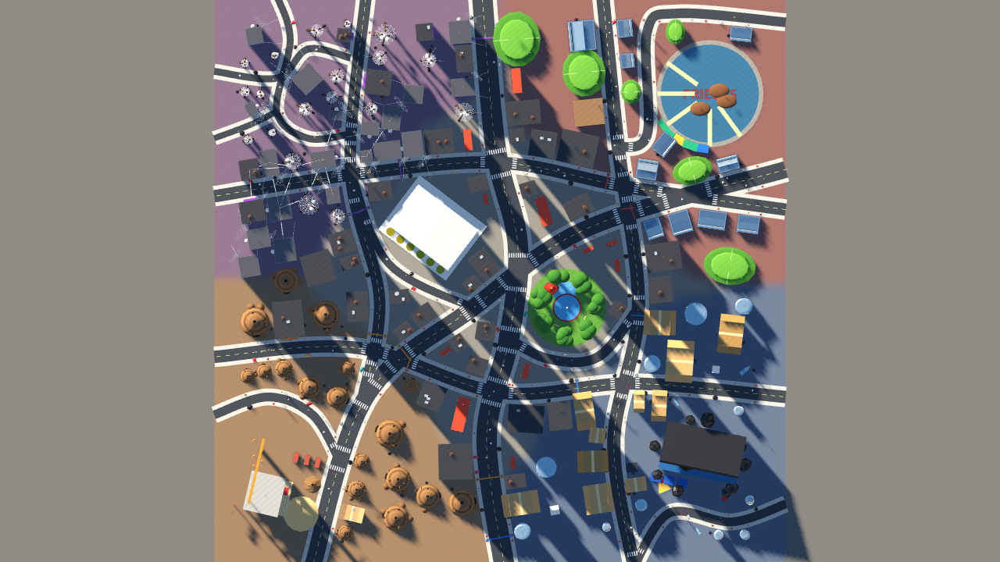
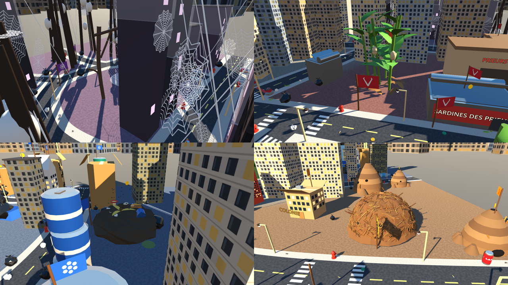
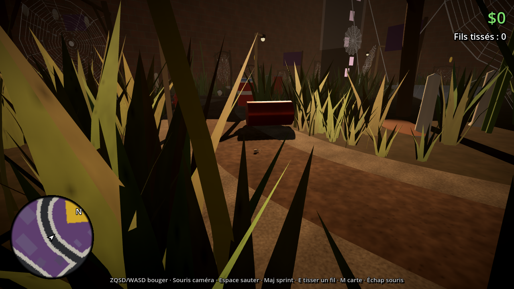
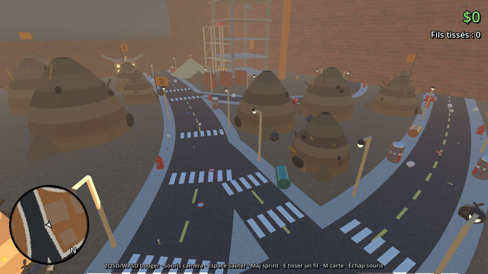

# La map : Spider Hood

Une ville d'insectes façon GTA, nichée au fond d'une ruelle entre des immeubles humains.
Projet **Godot 4.4** (renderer Compatibility, exportable en web). Ouvrir `project.godot` puis F5.

Échelle : **1 unité = 1 cm**, l'araignée fait environ 1,5 cm. La ville fait 12 m x 12 m.







## Les quartiers et les gangs

Pas de grille : 14 chemins de terre battue courbes (avenues, boulevard en diagonale, ruelles tortueuses)
bordés de gravier, avec des ornières et des pas japonais en cailloux plats à l'entrée des carrefours.
Entre les bâtiments pousse un terrain vague : près de 10 000 touffes d'herbe, plus des trèfles, des pissenlits,
des feuilles mortes et des champignons. Les immeubles sont alignés le long des rues,
façade vers la chaussée, puis l'arrière des îlots est rempli. Les quartiers ont des frontières qui serpentent ;
quand une rue entre dans un territoire, une borne et une bande de peinture aux couleurs du gang le signalent.
Chaque quartier est teinté de la couleur de son gang au sol, sur le radar et sur la carte (touche **M**).

Dans chaque territoire, la plupart des bâtiments sont ceux du gang (`scripts/city/gang_buildings.gd`) :
fourmilières en terre percées d'entrées pour la Colonie, tours sombres voilées de soie et faisceaux de brindilles
tendus de grosses toiles (avec cocons et fils d'ancrage sur lesquels on marche) pour les Tisseuses,
canettes empilées, bouteilles et cartons pour la Nuée, boîtes de sardines et temples de feuilles pour les Prieurs.
Si le fil des assets fournit `assets/models/gang_<gang>_<n>.glb`, ces modèles sont utilisés en priorité.

Au cœur de chaque territoire, sur la place libre la plus proche du centre du quartier, se trouve le repaire du gang
(`habitat_<gang>.glb` du fil des assets), entrée tournée vers la rue : le Repaire des Tisseuses, le Nid des Prieurs,
la Décharge de la Nuée et la Grande Fourmilière. Ils apparaissent sur la carte.






| Quartier | Gang | Couleur | Ce qu'on y trouve |
|---|---|---|---|
| Le Centre-Ville | neutre | beige | la Banque Centrale (colonnes en crayons, piles de pièces), les plus hautes tours au cœur, le parc rond avec une fontaine-capsule et la bouche d'incendie géante |
| La Toile (nord-ouest) | Les Tisseuses (araignées) | violet | ruelles serrées, immeubles sombres, néons, toiles tendues entre les toits (on peut marcher dessus) |
| Le Port de la Flaque (nord-est) | Les Prieurs (mantes) | rouge | une flaque d'eau sur laquelle on marche, pontons en bâtons de glace, conteneurs en boîtes d'allumettes, entrepôts |
| La Décharge (sud-est) | La Nuée (mouches) | bleu | la benne à ordures géante, sacs poubelle, part de pizza, trognon de pomme, cabanes en bâche |
| Le Chantier (sud-ouest) | La Colonie (fourmis) | orange | immeuble en construction à escalader, grue, briques, tas de sable, fourmilières, cônes |

Partout : lampadaires, bouches d'incendie, canettes, capsules, mégots, boulettes de papier, drapeaux et tags de gang.
En fond : murs de briques de la ruelle, une épicerie au sud, et un skyline de gratte-ciel dans la brume dorée.

## Ambiance

Fin de journée sous un ciel lourd et une brume de pollution. Un post-traitement plein écran (`scripts/fx/film_look.gd`)
ajoute un vignettage et des couleurs un peu désaturées (le grain de film est coupé, `grain = 0.0`). Toutes les
surfaces reçoivent une texture de crasse marquée en coordonnées monde (`Tex.grime()`). Les réglages (grain,
vignettage, contraste, saturation, teinte) sont en haut du shader.

Coins sales (`_dirty_areas()` dans `city.gd`) : jusqu'à 17 terrains vagues près des rues, 5 à la Décharge et 3 par autre quartier.
Chacun a des taches d'huile et de boue, un tas d'ordures (sacs, canettes, papiers, cartons, capsules, mégots) et
souvent un feu (8 fois sur 10 à la Décharge, 1 sur 2 ailleurs), dans un bidon rouillé ou à même un tas de cendres.
Les feux (`scripts/fx/fire.gd`) sont des particules de flammes et de fumée avec une lumière orange qui vacille.

## Jouer

- **ZQSD / WASD** bouger, **Maj** sprint, **Espace** sauter, **souris** caméra, **molette** zoom
- Pousser contre n'importe quel mur pour **grimper** ; lâcher les touches pour rester accroché ; Espace pour sauter du mur
- **E** accroche un fil, **E** encore le tend : il devient une passerelle sur laquelle on marche
- **M** carte des territoires, **Échap** libère la souris
- 25 **pièces** à trouver (5 par quartier), souvent sur les toits

## Code

| Fichier | Rôle |
|---|---|
| `scripts/city/layout.gd` | le plan : quartiers (centre et frontières), tracé des rues, lieux spéciaux |
| `scripts/city/city.gd` | construit la ville (sol, rues courbes, immeubles le long des rues, lieux spéciaux, fond) |
| `scripts/city/props.gd` | mobilier urbain et déchets, un objet par fonction |
| `scripts/city/builder.gd` | primitives avec collisions, fils de soie |
| `scripts/player/spider.gd` | déplacement, escalade, fils |
| `scripts/ui/hud.gd` | radar, nom du quartier, compteurs, carte |

Tout est généré en code au lancement avec une graine fixe : la ville est identique à chaque partie.

Pour modifier la ville : déplacer les points d'une rue dans `ROADS`, le cœur d'un quartier dans `ZONES`
(`seed`), ou un lieu dans `SITES`. Les immeubles se replacent tout seuls autour.

### Modèles du fil des assets (`assets/models/`)

- `epeire.glb` sert de joueuse (sinon une araignée en primitives).
- Membres de gang qui patrouillent sur les trottoirs de leur territoire : `spider_tisseuses`, `mantis_prieurs`, `fly_nuee`, `ant_colonie`.
- Mobilier et déchets : `fire_hydrant`, `soda_can`, `soda_can_lying`, `bottle_cap`, `trash_bag`, `crumpled_paper`, `cigarette_butt`, `street_lamp`, `dumpster`.
- Gangs : `flag_<gang>` sur les toits et trottoirs, `marker_<gang>` aux entrées de territoire.
- Immeubles : `building_tower` (centre), `building_carton` (Décharge), `building_box` (Chantier), plus `scaffolding` et `anthill` au chantier.
- Chaque modèle est mis à l'échelle et reçoit une collision en boîte. S'il manque, la version en primitives prend le relais.

### Captures automatiques

```sh
godot --path . -- --shots=/tmp/shots
```

Lance une série de vues de chaque quartier, la carte, et des tests d'escalade, de trottoir et de fil, puis quitte.

Avec `-- --shots=/tmp/shots --overview`, il fait plutôt des vues aériennes de toute la ville.

## Pistes pour la suite

- Véhicules insectes (scarabée, coccinelle) sur les rues
- Gangs qui réagissent quand on entre dans leur territoire
- Missions de livraison et prise de territoire
