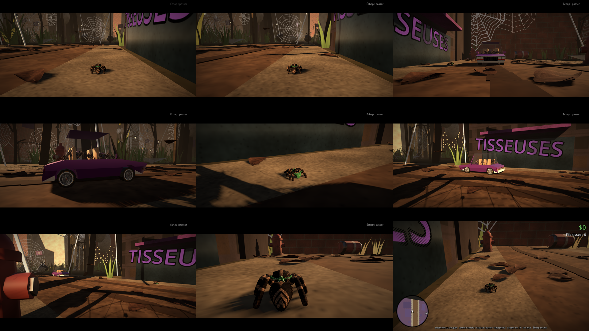

# Cinématique d'intro : « Tu tisses pas ? »

Jouée en temps réel après l'écran titre (`scripts/cinematics/intro_cutscene.gd`), avec les vrais modèles.
Environ 30 secondes, **Échap** pour la passer. Elle se termine sur la caméra du jeu, derrière le héros.

## Déroulé

| Plan | Ce qu'on voit |
|---|---|
| 1 | Bandes noires qui entrent. On suit le héros par derrière sur le trottoir de la Rue du Nord (La Toile). |
| 2 | Il s'arrête au bord du trottoir, se tourne vers la chaussée et attend pour traverser. |
| 3 | Le low rider violet des Tisseuses arrive droit sur la caméra et s'arrête devant lui. |
| 4 | Par-dessus son épaule : les trois Tisseuses le regardent (répliques 1 et 2). |
| 5 | Contrechamp depuis la voiture : il baisse la tête (réplique 3). |
| 6 | Plan large devant l'enseigne TISSEUSES : elles rigolent, la voiture saute sur ses vérins, puis repart dans les feuilles. |
| 7 | Il fait demi-tour et passe devant la caméra, qui se replace derrière lui. Les bandes sortent, l'interface revient : c'est le jeu. |

## Répliques et voix

Pas de texte à l'écran : les répliques seront écrites plus tard et doublées par IA. Chaque créneau a la durée
de sa réplique (table `LINES` en haut du script). Pour brancher une voix, déposer le fichier dans
`assets/audio/cinematics/` sous le nom `intro_replique_1.ogg`, `intro_replique_2.ogg`, `intro_replique_3.ogg`
ou `intro_rires.ogg` (.wav et .mp3 marchent aussi) ; il est joué automatiquement. Si la voix est plus longue,
allonger la durée du créneau dans `LINES`.

## Modèles

- Héros : `assets/spider_variants/jumping_spider_bandana.glb` (fil des assets), avec ses animations d'attente,
  de marche et de saut. Il remplace aussi l'araignée jouable en jeu (`scripts/player/hero_model.gd`).
- Tisseuses : `assets/models/spider_tisseuses.glb` (fil des assets).
- Low rider : la pimpmobile du dépôt good-spider-hood (`assets/vehicles/pimpmobile/`), repeinte en violet, vitres claires.

Sans les modèles du fil des assets, la cinématique tourne quand même avec des formes simples.

## Tester sans écran

    godot --path . -- --cutscene --shots=/tmp/shots

enregistre une image toutes les demi-secondes de la cinématique.
