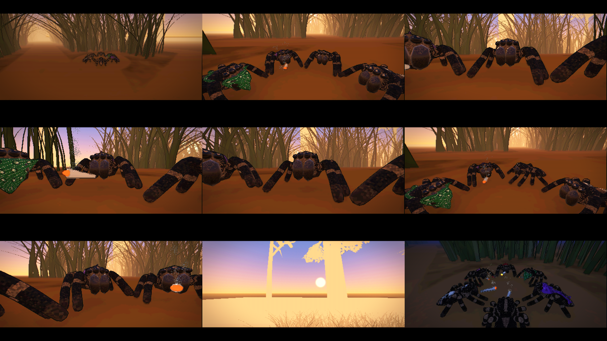
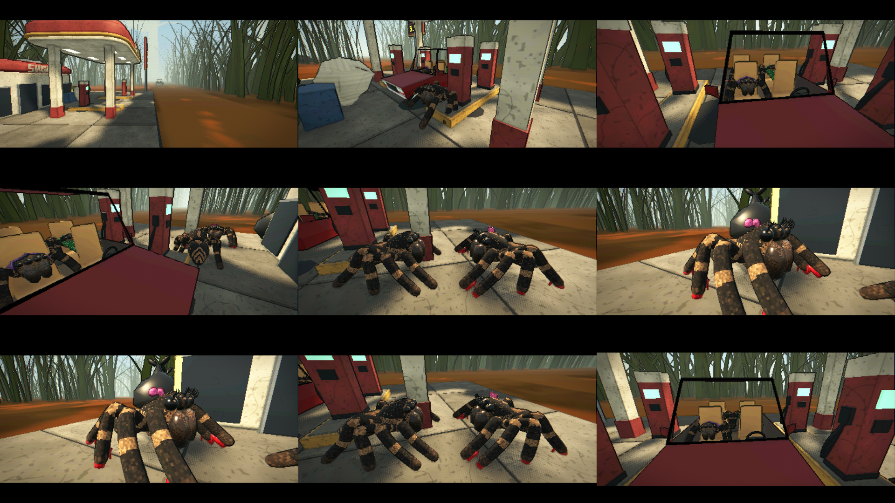

# Pour good-spider-hood

Ce dossier se copie tel quel à la racine du dépôt good-spider-hood : il ajoute les cinématiques des
missions dans `experiments/` et ne modifie aucun fichier existant. Ouvrir la scène de la cinématique
puis F6.

Les répliques sont celles du script (`dialogues/script-v2.md` dans le projet Game Jam), appelées par
leur numéro. Les voix sont dans `experiments/voices/`, un MP3 par réplique nommé `numéro_perso`
(par exemple `M2-15_girl.mp3`). Si un fichier manque, la réplique dure son temps prévu en silence.

| # | Cinématique | Répliques | Scène |
|---|---|---|---|
| 1 | Mission 1 : les Tisseuses en low rider | M1-01 à M1-08 | `experiments/intro_cutscene/intro_game.tscn` |
| 2 | Mission 1 : la toile ratée, elles repartent | M1-09 à M1-12 | `experiments/m1_end_cutscene/m1_end_game.tscn` |
| 3 | Mission 2 : coucher de soleil avec Bug Smoke | M2-01 à M2-10 | `experiments/sunset_cutscene/sunset_game.tscn` |
| 4 | Mission 2 : la drague à la station BUG OIL | M2-11 à M2-22 | `experiments/gas_cutscene/gas_game.tscn` |
| 5 | Mission 2 : le recal, emmêlé dans sa toile | M2-27 à M2-31 | `experiments/m2_turned_down_cutscene/m2_turned_down_game.tscn` |
| 6 | Mission 3 : Unc sur le trottoir, la nuit | M3-01 à M3-09 | `experiments/m3_unc_cutscene/m3_unc_game.tscn` |
| 7 | Mission 3 : le petit pendu au rocher | M3-10, M3-11 | `experiments/m3_rescue_cutscene/m3_rescue_game.tscn` |
| 8 | Fin : il lui donne son numéro | M3-14, FIN-01 à FIN-06 | `experiments/final_cutscene/final_game.tscn` |

Chaque dossier a un `README.txt` qui détaille les plans.

En attendant leurs designs, la fille est le modèle `spider_girl`, WS1 et WS2 sont les Tisseuses du
low rider, et le petit est le modèle bandana à 55 %. Unc est la vieille araignée voûtée avec sa
canne (`jumping_spider_old_hunched`).

Les répliques pendant le gameplay (M2-23 à M2-26, M3-12, M3-13) ne sont pas dans les cinématiques :
leurs voix sont dans `experiments/voices/` pour les missions.

