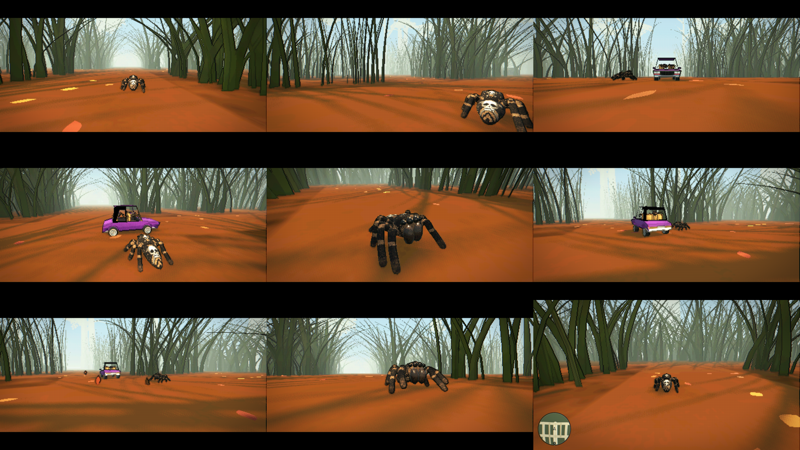

# Pour good-spider-hood

Ce dossier se copie tel quel à la racine du dépôt good-spider-hood : il ajoute `experiments/intro_cutscene/`
et ne modifie aucun fichier existant. Ouvrir `experiments/intro_cutscene/intro_game.tscn` puis F6.
Détails dans `experiments/intro_cutscene/README.txt`.

